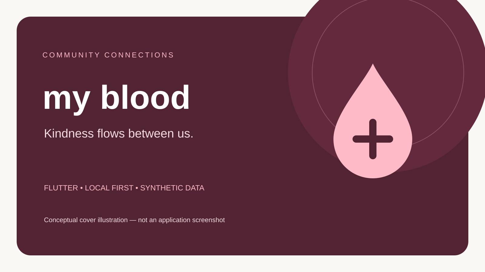
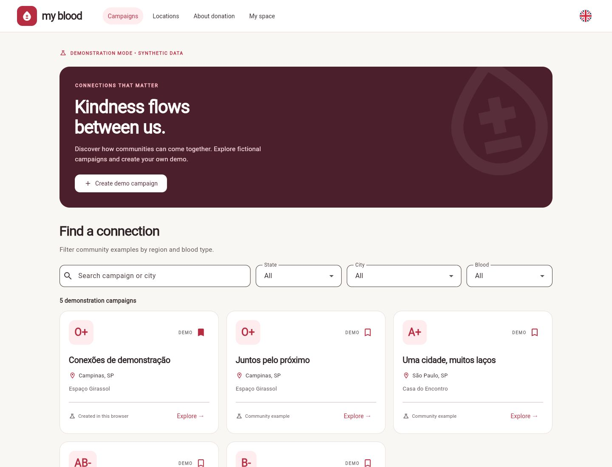

# My Blood



[](https://docs.flutter.dev/)
[](pubspec.yaml)
[](https://github.com/kleberandrade/my-blood-flutter/actions/workflows/verify.yml)
[](LICENSE)

A community blood-donation campaign **demonstration** with a responsive Flutter interface. Discover fictional campaigns, combine region and blood-type filters, create/edit local examples, and keep bookmarks across browser reloads. No account or backend setup is required.

**All campaigns and facility addresses are synthetic. This is not a clinical screening tool, a live donor network or an appointment service. Do not enter real personal or health data.**

## Run locally

Install Flutter **3.50.0**, which includes Dart **3.14.0**, from the [official SDK archive](https://docs.flutter.dev/install/archive). The tested SDK reports framework revision `ab2912035e`; `.flutter-version` records the release pin. A project-specific SDK/cache was used for validation without changing the shared Flutter installation.

```sh
git clone https://github.com/kleberandrade/my-blood-flutter.git
cd my-blood-flutter
flutter --version
flutter pub get --enforce-lockfile
flutter run -d chrome
```

For a release build with local renderer resources:

```sh
flutter build web --release --no-web-resources-cdn
python3 -m http.server 8743 --bind 127.0.0.1 --directory build/web
```

Open [the local application](http://127.0.0.1:8743). Keep the same origin/port when checking persistence. Initial dependency installation requires network access. A built site must be served over HTTP, not opened as a `file://` page. This project does not include an offline service worker or promise first-load offline support.

## Explore the demo

1. Open **Campaigns**. Search `sao paulo` to see accent-insensitive matching; choose SP, Campinas and O+ together to narrow the initial examples to one result. All eight ABO/Rh labels are exact filters, never clinical compatibility calculations.
2. Select **Create demo campaign**, enter a fictional title and description, and choose a fictional location/type. Titles require 5–80 trimmed characters; descriptions require 10–500. City/state come from the location so they cannot disagree.
3. Select **Explore → Edit** on a campaign you created. Seed examples are read-only. Saving creates or edits content only in this browser.
4. Bookmark a campaign and open **My space**. Reload the page to verify the campaign and bookmark remain. Switch PT-BR/EN using the circular flag control; authored campaign text is preserved.
5. Open **Sharing preview**, then **Copy demo text** if desired. No messenger is opened and no message is sent. The preview always marks the example as fictional; there are no public campaign links.
6. Read **About donation** for official references. **Locations** contains fictional facilities only. For actual donation services, use official sources and confirm all details with the hemocenter.

Use **My space → Clear my local data** to remove created campaigns, bookmarks and language preference after confirmation. If storage is corrupt or unavailable, the app shows a retry/reset screen; it does not silently discard data. Failed writes retain the previous screen state.

## Current screenshots

These are actual captures of the locally running release build, not mockups. The cover above is an original conceptual vector illustration.




## Architecture

- `lib/domain/campaign.dart`: validated campaign values, fictional location catalog, synthetic examples and pure combined filters.
- `lib/data/repository.dart`: `CampaignRepository` contract, versioned `DemoData` serialization and asynchronous local adapter.
- `lib/ui/app.dart`: navigation, local state transitions, catalog, profile, detail and sharing dialogs. Storage writes complete before UI state is committed; only one write runs at a time.
- `lib/ui/campaign_editor.dart`: form boundaries and local create/edit behavior.
- `lib/ui/information_pages.dart`: fictional locations and educational information with official references.
- `lib/ui/language_button.dart`: local vector flags and an accessible, labeled 48-pixel language control.
- `test/`: behavior tests covering domain, real persistence adapter with in-memory platform storage, interface workflows, links, clipboard and accessibility.

**Glossary:** campaign = synthetic community example; location = fictional facility; bookmark = saved campaign ID; local publication = persistence on this browser origin. None of these represents a donation, patient or clinical request.

The original Firebase/MobX implementation could not run without an external service and used obsolete non-null-safe packages. Its unavailable account and cloud modules were removed from the active path rather than presented as working login. Historical source remains in Git; the [historical README](docs/legacy-project.md) preserves the original research and screenshots. See the [integration contract](docs/integration.md) for the exact data shape, replacement boundary and future emulator requirements. No remote adapter or emulator is claimed to exist.

## Dependencies and verified limits

`pubspec.lock` is committed. Direct runtime packages are Material UI **1.11.1**, shared_preferences **2.5.6** and url_launcher **6.3.3**, with Flutter localization libraries. The active API path uses `package:material_ui/material_ui.dart`, replacing the deprecated Flutter Material re-export in this SDK. Development uses flutter_lints **6.0.0**, Flutter tests and platform interfaces for isolated tests.

The online `flutter pub outdated` check reported direct/development packages current on 17 November 2026. `material_color_utilities` **0.13.0** and `test_api` **0.7.14** remain pinned by the SDK, although **0.13.1** and **0.7.15** exist. No dependency overrides are used. The tested toolchain, not an unrestricted “latest” claim, defines compatibility.

Web is the validated target. Android/iOS support files were regenerated with the same SDK, preserving application identity `com.kleberandrade.myblood` and adding current brand icons. **No Android/iOS build, emulator, physical-device test or signing was performed.** Native external-link/storage behavior remains unverified. Distribution signing must be configured separately before a specifically authorized release; no SDK licenses were accepted.

Local storage is not encrypted, backed up or synchronized. Browser cleanup/private mode can remove data. One active editing tab is supported; concurrent tabs are last-writer-wins. Seed content remains Portuguese when switching the interface to English, just like user-authored campaign text. Official external links need connectivity, and browser policies can block a new window or clipboard access; failures are surfaced.

## Verification

```sh
dart format --output=none --set-exit-if-changed lib test
flutter analyze --no-pub
flutter test --no-pub
flutter build web --release --no-pub --no-web-resources-cdn
flutter pub outdated
```

Analysis, 12 tests and the release Web build passed locally. Browser checks cover desktop/mobile layouts, actual creation/bookmark persistence after reload, language preservation, sharing preview and empty search. Accessibility tests cover labeled touch targets and 1.6× text on a 390-pixel viewport. These checks do not constitute a full assistive-technology audit. See [validation details](docs/validation.md), [privacy](docs/privacy.md), [contribution guide](CONTRIBUTING.md) and [changelog](CHANGELOG.md).

## Teaching material and publication

A concrete Portuguese [lesson revision](docs/lesson-revision.pt-BR.md) includes verified examples, current captures, official references and exactly five final exercises. No related Medium URL was found in the repository or a focused public search, and no editable lesson was identified. No article was changed or newsletter sent. The draft must be matched to the author's original URL before editorial publication.

Repository code/documentation push and metadata updates are within the modernization authorization. No app hosting, backend, package, store release or production deployment is included or authorized by this work.

## Authors, research and license

Original project copyright **2019–2020 Kleber de Oliveira Andrade**. The original README contains an MIT grant; it is now retained in [LICENSE](LICENSE), with authorship intact.

Original acknowledgments: Grabriela Dall'Agnol (Texugo), Guilbert Adalson de Oliveira, Jessica Mariane Pereira, Kleber de Oliveira Andrade, Ricki Warley Villanueva Mujica, Romanti-Ezer Gomes dos Santos and Silas Rodrigues Gouveia Junior.

OLIVEIRA, Guilbert Adalson de; MUJICA, Ricki Warley Villanueva; SANTOS, Romanti-Ezer Gomes dos; GOUVEIA JUNIOR, Silas Rodrigues; ANDRADE, Kleber de Oliveira. **Desenvolvimento de um aplicativo para divulgar campanhas de doação de sangue**. Monograph, Faculdade de Tecnologia de Americana, Centro Estadual de Educação Tecnológica Paula Souza, 92 pages, 2019. [Original research document](https://drive.google.com/open?id=1mZAEDbrhYGrC_kcInRjU1zXDi6mH93qO).
