# My Blood

[](https://github.com/kleberandrade/my-blood-flutter/blob/master/pubspec.yaml)
[](https://github.com/kleberandrade/my-blood-flutter/blob/master/pubspec.yaml)

Flutter app prototype for discovering and publishing community blood-donation campaigns.

## Getting started

- Select a Flutter release whose bundled Dart SDK satisfies the manifest constraint, then run the commands below from the repository root.

```sh
flutter pub get
flutter run
```

- If the app depends on Firebase or another external service, configure your own service project using the dependencies and original notes; credentials are not supplied by this guide.

## Recorded requirements

- Dart SDK constraint from [`pubspec.yaml`](https://github.com/kleberandrade/my-blood-flutter/blob/master/pubspec.yaml): `>=2.7.0 <3.0.0`.

## Repository map

- [lib](https://github.com/kleberandrade/my-blood-flutter/tree/master/lib)
- [android](https://github.com/kleberandrade/my-blood-flutter/tree/master/android)
- [ios](https://github.com/kleberandrade/my-blood-flutter/tree/master/ios)

## Validation status

This update documents the tracked source and project metadata. It does not certify a successful build, device test or compatibility with a current toolchain. Follow any project-specific validation instructions in the original material.

## License and attribution

No standalone repository-wide license file was identified in this review. Preserve the original credits and any component-specific licenses; this documentation update grants no additional rights.

---

## Original project material

# My Blood

Aplicativo para tornar as doações de sangue mais simples tanto para quem precisa do sangue quanto para o doador, possibilitando que a própria comunidade publique campanhas de doação e que os doadores consigam filtrar estas campanhas por estado, cidade e tipo de sangue.

## Screenshots

<p align="center">
    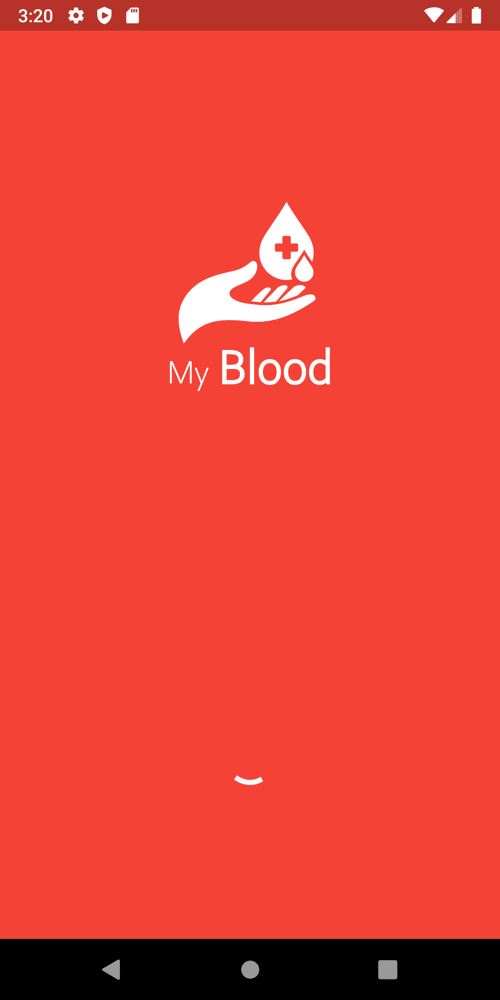
    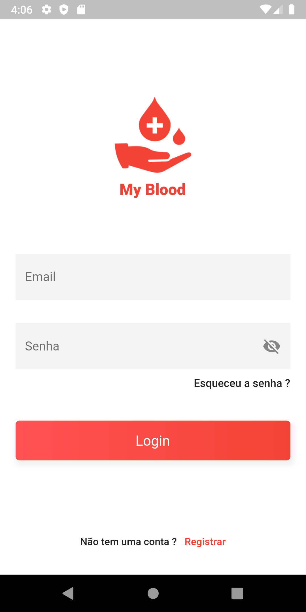
    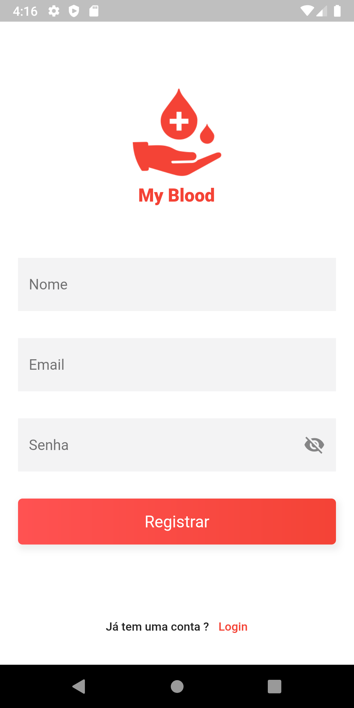
    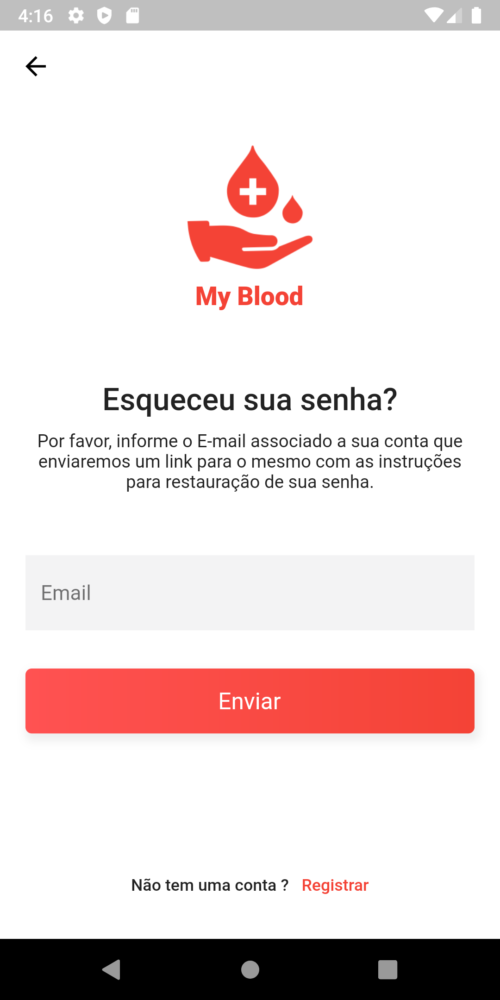
</p>

<p align="center">
    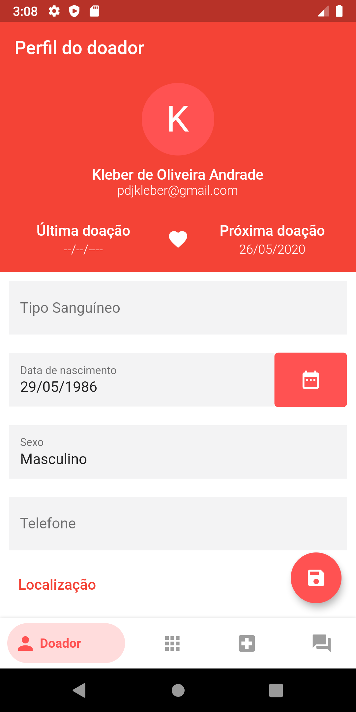
    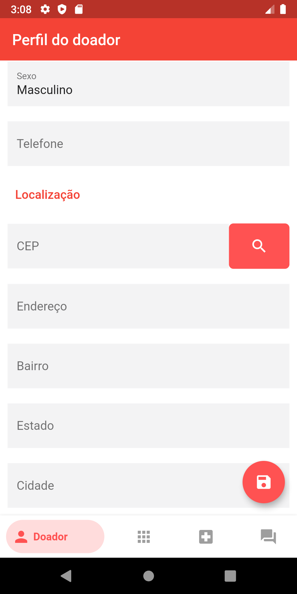
    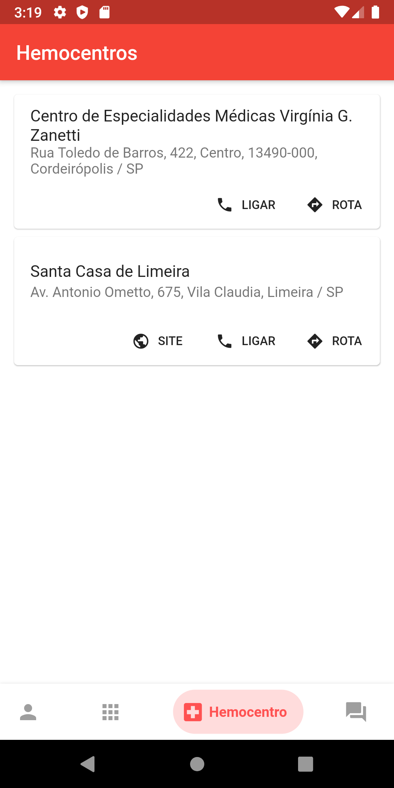
    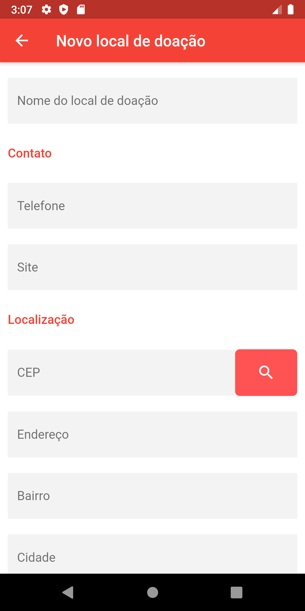
</p>

<p align="center">
    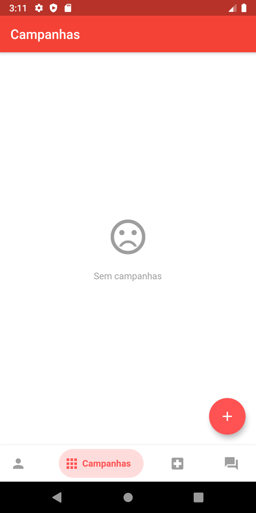
    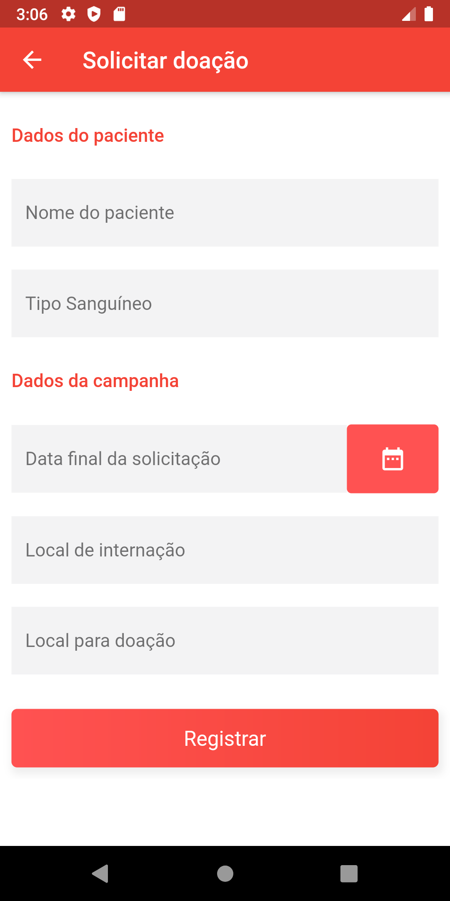
    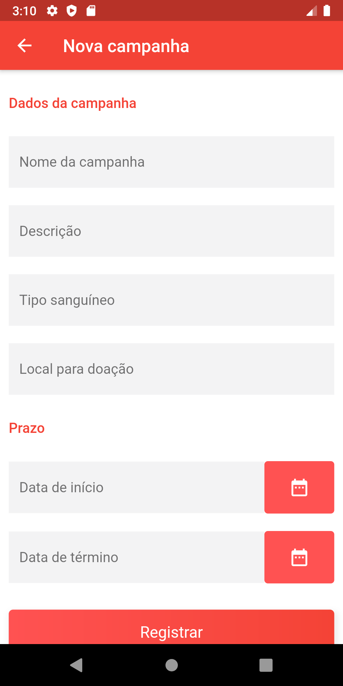
    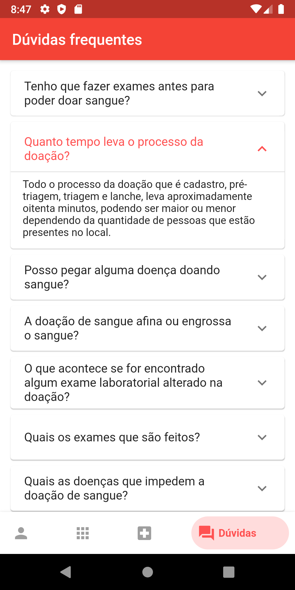
</p>

## Funcionalidades

- [x] Splash screen
- [x] Login com email e senha
- [x] Registrar novo usuário
- [x] Esqueceu a senha?
- [x] Perfil do usuário
- [x] Trocar foto do perfil
- [ ] Histórico de doações
- [x] Cadastrar campanhas
- [x] Listar campanhas
- [ ] Compartilhar campanhas
- [ ] Registrar doação em campanhas
- [x] Cadastrar locais para doação
- [x] Listar locais para doação
- [x] Dúvidas frequentes (FAQ)
- [ ] Chatbot
- [ ] Notificações

## Organização do código

<p align="center">
    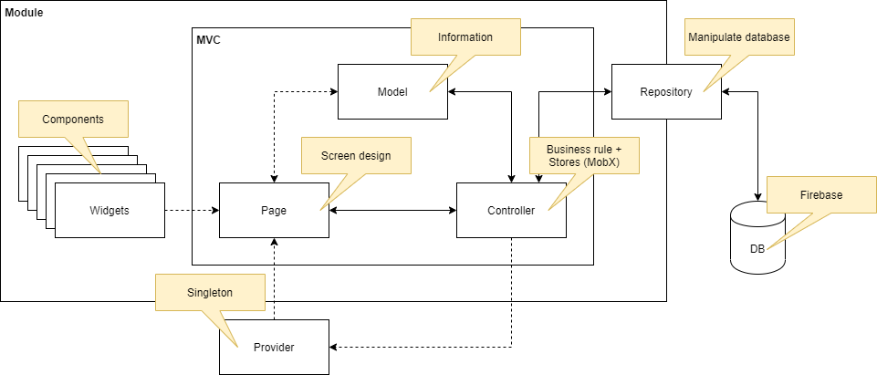
</p>

### Ferramentas e Recursos

- [x] Dart / Flutter
- [x] Firebase
- [x] Provider
- [x] MobX
- [x] MVC
- [x] Flushbar
- [x] Splashscreen
- [x] Bottom Navy Bar
- [x] Url Launcher
- [x] Maps Launcher
- [x] Expansion Tile Card

## Publicações

- OLIVEIRA, Guilbert Adalson de, MUJICA, Ricki Warley Villanueva; SANTOS, Romanti-Ezer Gomes dos; GOUVEIA JUNIOR, Silas Rodrigues; ANDRADE, Kleber de Oliveira. **Desenvolvimento de um aplicativo para divulgar campanhas de doação de sangue**. Monografia (Curso Superior de Tecnologia em Análise e Desenvolvimento de Sistemas) - Faculdade de Tecnologia de Americana – Centro Estadual de Educação Tecnológica Paula Souza. 92p, 2019. Disponível em <[https://drive.google.com/open?id=1mZAEDbrhYGrC_kcInRjU1zXDi6mH93qO](https://drive.google.com/open?id=1mZAEDbrhYGrC_kcInRjU1zXDi6mH93qO)>.

## Downloads

<p align="center">
<a href='https://play.google.com/store/apps/details?id=com.kleberandrade.myblood'></a>
</p>

## Agradecimentos

- Grabriela Dall'Agnol (Texugo)
- Guilbert Adalson de Oliveira
- Jessica Mariane Pereira
- Kleber de Oliveira Andrade
- Ricki Warley Villanueva Mujica
- Romanti-Ezer Gomes dos Santos
- Silas Rodrigues Gouveia Junior

## Licença

    Copyright 2019-2020 Kleber de Oliveira Andrade

    Permission is hereby granted, free of charge, to any person obtaining a copy
    of this software and associated documentation files (the "Software"), to deal
    in the Software without restriction, including without limitation the rights
    to use, copy, modify, merge, publish, distribute, sublicense, and/or sell
    copies of the Software, and to permit persons to whom the Software is
    furnished to do so, subject to the following conditions:

    The above copyright notice and this permission notice shall be included in all
    copies or substantial portions of the Software.

    THE SOFTWARE IS PROVIDED "AS IS", WITHOUT WARRANTY OF ANY KIND, EXPRESS OR
    IMPLIED, INCLUDING BUT NOT LIMITED TO THE WARRANTIES OF MERCHANTABILITY,
    FITNESS FOR A PARTICULAR PURPOSE AND NONINFRINGEMENT. IN NO EVENT SHALL THE
    AUTHORS OR COPYRIGHT HOLDERS BE LIABLE FOR ANY CLAIM, DAMAGES OR OTHER
    LIABILITY, WHETHER IN AN ACTION OF CONTRACT, TORT OR OTHERWISE, ARISING FROM,
    OUT OF OR IN CONNECTION WITH THE SOFTWARE OR THE USE OR OTHER DEALINGS IN THE
    SOFTWARE.
