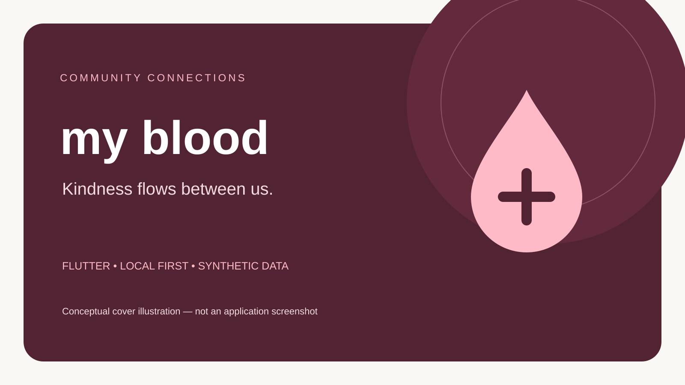
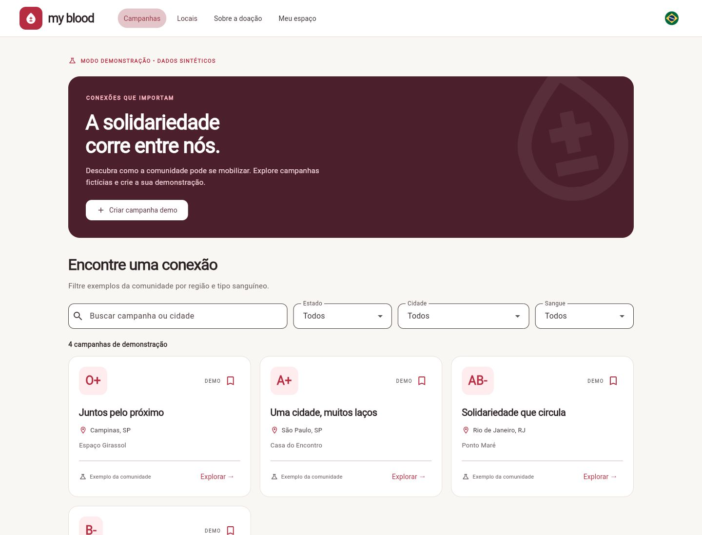
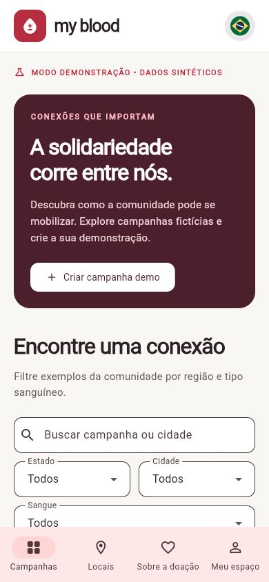
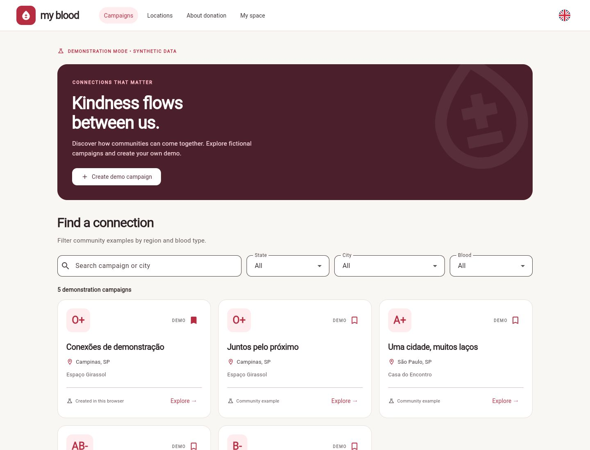

# My Blood: campanhas comunitárias com Flutter e persistência local

> Revisão editorial preparada em 17/11/2026. Não publicada. Nenhuma URL de aula do Medium foi encontrada no repositório ou na busca pública direcionada, e nenhuma página editorial foi identificada. Vincule este texto à aula original do autor antes de substituir conteúdo, preservando idioma, URL e autoria. Não enviar newsletter.



*Capa vetorial conceitual criada para esta revisão; não é uma captura do aplicativo.*

O My Blood começou como um protótipo para divulgar campanhas de doação de sangue. Nesta atualização, vamos estudar o catálogo, os filtros e a publicação local usando dados inteiramente sintéticos. O objetivo é aprender a construir uma experiência funcional sem depender de credenciais de nuvem nem confundir uma demonstração com um serviço de saúde.

Este aplicativo não diagnostica, não faz triagem e não decide quem pode doar. Tipos sanguíneos são apenas rótulos usados em filtros exatos. Critérios individuais e orientações atuais pertencem ao serviço de hemoterapia.

## 1. Preparar uma execução reproduzível

A versão do aplicativo é **1.0.0+9**. Use **Flutter 3.50.0**, com **Dart 3.14.0**, e o `pubspec.lock` do repositório. O ambiente validado reportou a revisão Flutter `ab2912035e`.

```sh
git clone https://github.com/kleberandrade/my-blood-flutter.git
cd my-blood-flutter
flutter --version
flutter pub get --enforce-lockfile
flutter run -d chrome
```

Material UI 1.11.1 fornece a interface atual; shared_preferences 2.5.6 mantém o estado local; url_launcher 6.3.3 abre somente as referências oficiais. A importação ativa da interface é `package:material_ui/material_ui.dart`. Não é necessário criar projeto Firebase. A implementação Firebase/MobX antiga permanece no histórico e não deve ser usada como instrução de instalação atual.

As dependências diretas estavam atualizadas na verificação online. Duas dependências transitivas permanecem fixadas pelo SDK: material_color_utilities 0.13.0 e test_api 0.7.14. Não use overrides para forçar versões incompatíveis.

## 2. Modelar o domínio antes da tela

Em `lib/domain/campaign.dart`, uma campanha tem identificador, título, descrição, tipo sanguíneo e local fictício. A cidade e o estado precisam corresponder ao local escolhido. O construtor remove espaços externos e rejeita títulos fora de 5–80 caracteres, descrições fora de 10–500, locais desconhecidos e tipos não reconhecidos.

Exemplo compatível com o modelo final:

```dart
final campaign = Campaign(
  id: 'local-example',
  title: 'Campanha de exemplo',
  city: 'Campinas',
  state: 'SP',
  blood: 'O+',
  locationId: 'campinas',
  description: 'Uma mobilização inteiramente fictícia para estudo.',
  local: true,
);
```

Importe o modelo com `import 'package:my_blood/domain/campaign.dart';` em um teste ou arquivo Dart do projeto. A estrutura equivalente de persistência está em `docs/integration.md`. A validação acontece tanto no formulário quanto ao reconstruir valores armazenados: dados externos não são confiados apenas por terem sido gravados anteriormente.

## 3. Combinar filtros sem duplicar regras

O catálogo combina estado, cidade, tipo sanguíneo e uma busca sem distinção de maiúsculas ou dos acentos portugueses tratados pela função `normalize`. Os filtros são cumulativos: SP, Campinas e O+ retornam um dos quatro exemplos iniciais; RJ com Campinas retorna uma lista vazia.

```dart
final visible = filterCampaigns(
  seedCampaigns,
  state: 'SP',
  city: 'Campinas',
  blood: 'O+',
);
assert(visible.length == 1);
assert(filterCampaigns(seedCampaigns, query: 'sao paulo').length == 1);
```

A normalização é deliberadamente pequena e voltada aos exemplos brasileiros, não um mecanismo universal de busca linguística. Ao trocar o estado, a tela limpa a cidade selecionada para não manter uma combinação impossível. O estado vazio explica que nada corresponde à busca e oferece a limpeza dos filtros.



*Captura real do build Web local. Nenhuma campanha exibida corresponde a uma necessidade de sangue real.*

## 4. Persistir apenas o que a demonstração promete

`CampaignRepository` separa a interface da origem de dados. O adaptador atual usa `SharedPreferencesAsync`, salva um registro JSON com versão e restaura campanhas, favoritos e idioma. O teste de persistência grava com uma instância e lê com outra, usando o armazenamento em memória fornecido pela interface de plataforma do plugin.

A operação de gravação precisa terminar antes de a tela adotar o novo estado. Se o navegador negar a escrita, o aplicativo mantém o estado anterior e mostra uma mensagem. Se a leitura encontrar JSON inválido ou uma versão desconhecida, mostra erro e permite tentar novamente; não substitui o registro silenciosamente. A limpeza exige uma confirmação explícita.

No navegador, os dados pertencem à origem, incluindo a porta. Use sempre a mesma URL para testar o recarregamento. A aplicação não oferece backup, criptografia ou sincronização entre dispositivos. Duas abas podem sobrescrever o mesmo registro: use uma aba de edição.

## 5. Criar, editar e compartilhar com limites claros

O botão de criar abre um formulário com campos limitados e mensagens de validação. Salvar publica somente no navegador atual. Exemplos iniciais são somente leitura; campanhas locais podem ser editadas. Um favorito salva apenas o identificador, não uma intenção de doação ou agendamento.

A prévia de compartilhamento mostra texto selecionável. Copiar é uma segunda ação explícita. O conteúdo contém `[DEMO • SYNTHETIC DATA]`, informa que a campanha é fictícia e não inclui link público. Nenhum mensageiro é aberto e nenhuma mensagem é enviada.

Os locais têm endereços fictícios e não oferecem rotas, horários ou agendamentos. Para uma doação real, o usuário deve consultar as fontes oficiais e confirmar as informações com o hemocentro.

## 6. Tornar a interface acessível e preservar os dados

A navegação usa abas no computador e uma barra inferior em telas estreitas. Os controles têm rótulos e áreas de toque adequadas. As bandeiras circulares Brasil/Reino Unido são desenhadas localmente; o tooltip explica a ação de idioma. A troca altera os textos da interface, preservando os títulos e descrições escritos pela pessoa. Os exemplos sintéticos em português também são preservados.



*Captura real de uma viewport móvel. Trata-se da versão Web; não representa teste em aparelho físico.*



*O conteúdo da campanha é preservado; o idioma da interface pode mudar.*

Os testes incluem viewport de 390 pixels, texto ampliado em 1,6×, rótulos acessíveis e tamanho dos alvos de toque. Isso não substitui uma auditoria completa com leitores de tela e usuários de tecnologias assistivas.

## 7. Verificar antes de publicar

```sh
dart format --output=none --set-exit-if-changed lib test
flutter analyze --no-pub
flutter test --no-pub
flutter build web --release --no-pub --no-web-resources-cdn
python3 -m http.server 8743 --bind 127.0.0.1 --directory build/web
```

A análise, os 12 testes e o build Web passaram. Os testes cobrem filtros, validação, serialização, corrupção de dados, favoritos, criação/edição, falhas de gravação, idioma, links oficiais com adaptador de teste e cópia sem envio. A inspeção real em navegador complementa esses testes para observar a interface e confirmar a persistência após recarregar.

Arquivos Android/iOS foram atualizados para os modelos do SDK, mas não houve build nativo, emulador, teste físico ou configuração de assinatura. Não há integração Firebase ativa nem emulador implementado. O contrato de integração é uma base para uma etapa futura autorizada, com dados sintéticos, regras de acesso e testes próprios.

## Referências e créditos

- [Código e instruções atuais](https://github.com/kleberandrade/my-blood-flutter)
- [Arquivo oficial do Flutter](https://docs.flutter.dev/install/archive)
- [shared_preferences](https://pub.dev/packages/shared_preferences) e [url_launcher](https://pub.dev/packages/url_launcher)
- [Doação de sangue — Ministério da Saúde](https://www.gov.br/saude/pt-br/composicao/saes/doacao-de-sangue/doacao-de-sangue/)
- [Perguntas frequentes — Ministério da Saúde](https://www.gov.br/saude/pt-br/composicao/saes/doacao-de-sangue/faq)

Fontes de saúde consultadas em 17/11/2026. Elas fornecem informação geral; a avaliação individual pertence ao hemocentro.

Projeto original: Kleber de Oliveira Andrade, copyright 2019–2020, licença MIT preservada. Agradecimentos originais: Grabriela Dall'Agnol (Texugo), Guilbert Adalson de Oliveira, Jessica Mariane Pereira, Ricki Warley Villanueva Mujica, Romanti-Ezer Gomes dos Santos e Silas Rodrigues Gouveia Junior. A monografia de Oliveira, Mujica, Santos, Gouveia Junior e Andrade, **Desenvolvimento de um aplicativo para divulgar campanhas de doação de sangue**, Fatec Americana, 2019, 92 páginas, está [disponível na referência original](https://drive.google.com/open?id=1mZAEDbrhYGrC_kcInRjU1zXDi6mH93qO).

## Exercícios práticos

1. **Filtros combinados:** escreva um teste com estado, cidade e tipo sanguíneo. Conclusão: uma combinação válida encontra o exemplo esperado e uma combinação incompatível retorna uma lista vazia.
2. **Limites de validação:** teste títulos com 4, 5, 80 e 81 caracteres. Conclusão: apenas os comprimentos de 5 a 80 são aceitos, e a descrição permanece sintética.
3. **Persistência e idioma:** crie uma campanha fictícia, salve-a, marque como favorita, troque o idioma e recarregue na mesma origem. Conclusão: os campos originais e o favorito permanecem, com a interface no idioma escolhido.
4. **Recuperação de falhas:** injete um repositório que rejeita uma gravação. Conclusão: a tela mostra a falha e o estado anterior continua intacto; nenhum registro é descartado silenciosamente.
5. **Compartilhamento acessível:** abra a prévia usando teclado em largura de celular e copie o texto com o adaptador de teste. Conclusão: o texto contém o aviso DEMO, o alvo tem rótulo e tamanho adequados, e nenhum link ou mensagem real é disparado.
